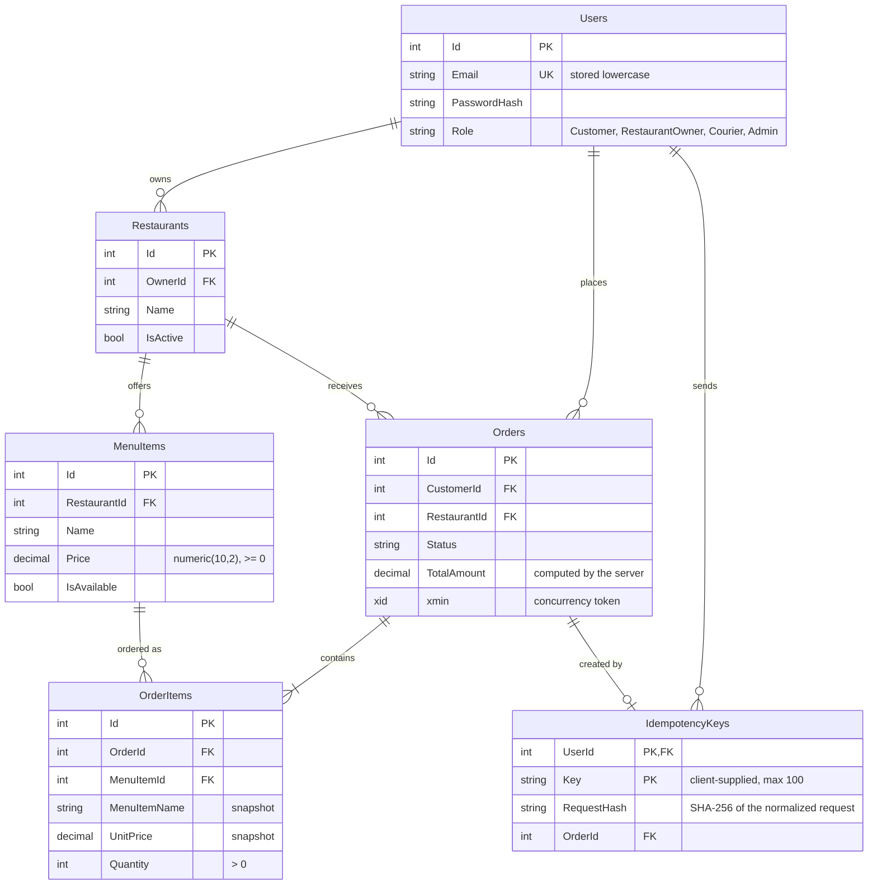
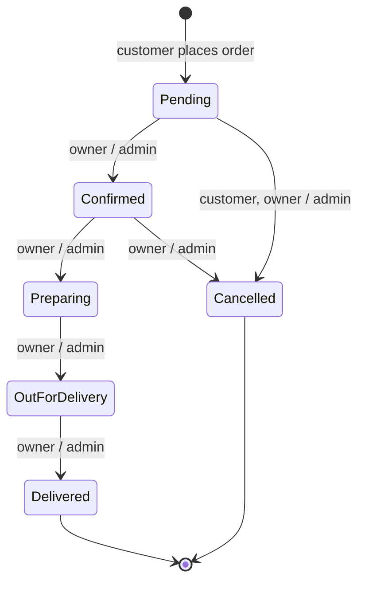

# Food Delivery Backend

[](https://github.com/yasin-aldasuqi/food-delivery-backend/actions/workflows/ci.yml)

A REST API for a food-delivery platform: customers browse restaurants and place orders, restaurant owners manage their menus and move orders through a delivery workflow, and admins oversee everything.

Built with **ASP.NET Core (.NET 10)**, **Entity Framework Core**, and **PostgreSQL**. Unit and integration tests run against a real database in CI.

## Contents

- [Features](#features)
- [Tech stack](#tech-stack)
- [Getting started](#getting-started)
- [API overview](#api-overview)
- [Data model](#data-model)
- [Order lifecycle](#order-lifecycle)
- [Design decisions](#design-decisions)
- [Testing](#testing)
- [Continuous integration](#continuous-integration)
- [Project structure](#project-structure)
- [Known limitations and roadmap](#known-limitations-and-roadmap)

## Features

- **JWT authentication.** Register, log in, and query the current user. Roles are `Customer`, `RestaurantOwner`, and `Admin`.
- **Restaurants and menus.** Anyone can browse them. Only a restaurant's owner, or an admin, can change a restaurant or its menu.
- **Orders.** Prices and totals are computed on the server. Each user sees only the orders that concern them.
- **Order workflow.** A state machine controls status changes: `Pending → Confirmed → Preparing → OutForDelivery → Delivered`, or `Cancelled`.
- **Concurrency safety.** Simultaneous updates to the same order are detected instead of silently overwriting each other.
- **History is preserved.** Past orders keep the item names and prices that were in effect when they were placed.
- **Idempotent order creation.** Retrying `POST /api/orders` with the same `Idempotency-Key` returns the original order instead of creating a duplicate, even when the retries arrive at the same moment.

## Tech stack

| Area | Technology |
|---|---|
| Framework | ASP.NET Core Web API, .NET 10 |
| Data access | Entity Framework Core 10, code-first migrations |
| Database | PostgreSQL 16 through Npgsql, run with Docker Compose |
| Auth | JWT bearer tokens; ASP.NET Core `PasswordHasher` (PBKDF2) |
| Tests | xUnit, `WebApplicationFactory`, Testcontainers |
| CI | GitHub Actions |

## Getting started

### Prerequisites

- [.NET 10 SDK](https://dotnet.microsoft.com/download)
- [Docker](https://docs.docker.com/get-docker/), for the database and the integration tests

### Run locally

```bash
# 1. Start PostgreSQL (bound to 127.0.0.1:5432)
docker compose up -d

# 2. Restore the pinned EF Core CLI (dotnet-ef) from the tool manifest
dotnet tool restore

# 3. Create a JWT signing key. Do this once per machine; it is stored outside the repo in user-secrets.
dotnet user-secrets set "Jwt:Key" "$(openssl rand -base64 64)" --project src/FoodDelivery.Api

# 4. Create the database schema
dotnet ef database update --project src/FoodDelivery.Api

# 5. Run the API (http://localhost:5127)
dotnet run --project src/FoodDelivery.Api
```

In Development, the OpenAPI document is served at `http://localhost:5127/openapi/v1.json`.

[`src/FoodDelivery.Api/FoodDelivery.Api.http`](src/FoodDelivery.Api/FoodDelivery.Api.http) contains ready-made requests for the whole flow: register, log in, create a restaurant, add menu items, place an order, and update its status. You can run them from VS Code (REST Client extension) or JetBrains Rider. The login responses' tokens are reused automatically in later requests.

### Creating an admin

Users can't register as admins; this is intentional. To create one, register a normal account and promote it in the database:

```sql
UPDATE "Users" SET "Role" = 'Admin' WHERE "Email" = 'you@example.com';
```

Then log in again. The role is read from the token, so the old token still carries the previous role.

## API overview

| Method | Endpoint | Access |
|---|---|---|
| `POST` | `/api/auth/register` | Public (role: `Customer` or `RestaurantOwner`) |
| `POST` | `/api/auth/login` | Public |
| `GET` | `/api/auth/me` | Any authenticated user |
| `GET` | `/api/restaurants?page=&pageSize=` | Public |
| `GET` | `/api/restaurants/{id}` | Public; inactive restaurants are visible only to their owner and admins |
| `POST` | `/api/restaurants` | `RestaurantOwner`; the owner is taken from the token |
| `PUT` / `DELETE` | `/api/restaurants/{id}` | The restaurant's owner, or `Admin` |
| `GET` | `/api/restaurants/{restaurantId}/menu-items[/{id}]` | Public |
| `POST` / `PUT` / `DELETE` | `/api/restaurants/{restaurantId}/menu-items[/{id}]` | The restaurant's owner, or `Admin` |
| `POST` | `/api/orders` | `Customer`; requires an `Idempotency-Key` header |
| `GET` | `/api/orders?status=&page=&pageSize=` | Customer: own orders. Owner: orders for their restaurants. Admin: all orders |
| `GET` | `/api/orders/{id}` | The customer, the restaurant's owner, or `Admin` (404 for anyone else) |
| `PATCH` | `/api/orders/{id}/status` | Depends on the transition; see [Order lifecycle](#order-lifecycle) |

Errors use the standard [Problem Details](https://www.rfc-editor.org/rfc/rfc9457) format: `400` for validation errors, `401` when the caller isn't authenticated, `403` when the caller isn't allowed, `404` for missing (or private) resources, `409` for conflicts, and `422` when an `Idempotency-Key` is reused for a different request.

## Data model



**Delete behavior.** Deleting a restaurant deletes its menu, and deleting an order deletes its lines (`CASCADE`). A user, restaurant, or menu item that is referenced by orders can't be deleted (`RESTRICT`), and the API returns `409`. To take one out of service, deactivate it instead (`IsActive` / `IsAvailable = false`).

## Order lifecycle



The allowed transitions are defined on the `Order` entity itself (`Order.CanTransitionTo`), so no endpoint can bypass them. A transition that isn't allowed returns `409`. A caller who can see the order but isn't permitted to make that change gets `403`.

## Design decisions

**DTOs instead of exposing entities.** Requests and responses use separate contract types. This stops sensitive fields such as `PasswordHash` from leaking. It also prevents over-posting, where a client sets fields like `OwnerId` or `Id` that it shouldn't control. It avoids reference cycles during JSON serialization, and it lets the database schema change without breaking API clients.

**The server is the source of truth for money.** An order request contains only menu item IDs and quantities. Prices come from the database and the total is computed on the server, so a tampered request can't change what the customer pays.

**Snapshots for financial history.** `OrderItem` stores the price and name at the time of the order. If a restaurant later renames an item or changes its price, past receipts don't change.

**Fluent API configuration.** Database rules (lengths, `numeric(10,2)`, unique email, check constraints, delete behavior) live in `IEntityTypeConfiguration<T>` classes, which keeps the entities free of persistence details. The constraints are enforced by PostgreSQL itself, so invalid data is rejected even if application code has a bug.

**Secure by default.** A fallback authorization policy requires authentication on every endpoint. Public endpoints must opt out explicitly with `[AllowAnonymous]`. If someone adds an endpoint and forgets to protect it, it is closed rather than open.

**Role checks plus ownership checks.** Every restaurant owner has the same role, so the role alone can't decide who may edit a given restaurant. Write operations also compare the restaurant's `OwnerId` with the user ID from the token. Menu items are always looked up by both their own ID and the restaurant ID from the URL, which prevents IDOR (insecure direct object reference) through another restaurant's URL.

**404 vs 403.** Restaurants are public, so editing someone else's restaurant returns `403`. Orders are private, so another user's order returns `404`; a `403` would confirm that the order exists.

**Password storage.** Passwords are hashed with ASP.NET Core's `PasswordHasher`, which uses PBKDF2 with a per-user salt. The hash is upgraded automatically at login if the algorithm's settings get stronger. Login returns the same error, with similar timing, for an unknown email and a wrong password, so attackers can't use it to find out which emails are registered.

**JWT configuration.** The API validates the token's issuer, audience, lifetime (with a 30-second clock skew), and signature. The signing key is never committed: it comes from user-secrets in development and from environment variables elsewhere. The app refuses to start if the key is missing or shorter than 32 bytes.

**Optimistic concurrency.** `Order` uses PostgreSQL's `xmin` system column as a concurrency token, so EF Core issues `UPDATE ... WHERE "Id" = @id AND xmin = @version`. Suppose an owner confirms an order at the same moment the customer cancels it. Whichever write lands second fails with `409` and doesn't overwrite the first. No extra column and no row locks are needed.

**Idempotent order creation.** Networks can lose a response after the server has already processed the request. The client can't tell a lost request from a lost response, so it retries, and without protection that creates a second order and a second charge. Clients therefore send an `Idempotency-Key` header (for example, a UUID) that is new for each order and the same for every retry of it:

- The key is stored together with the order in the same transaction, under the composite primary key `(UserId, Key)`, so keys are scoped per user.
- A retry with the same key returns the original order with `201` and `Idempotent-Replayed: true`. The response reflects the order's current state.
- The request is fingerprinted with a SHA-256 hash of a normalized form (items sorted, address trimmed). Reusing a key with a *different* request returns `422`, because that is a client bug rather than a retry.
- Only successful requests store a key, so a request that failed validation can be corrected and retried with the same key.
- Concurrent duplicates are resolved by the database, not by the check-then-insert lookup. The second insert of the same `(UserId, Key)` waits for the first transaction, then fails with a unique violation. That rolls back its entire transaction, duplicate order included, and the API replays the winning order. The lookup is only a fast path for ordinary retries.

**Atomic writes.** An order and all of its lines are saved in a single `SaveChanges` call, which runs in one transaction. Either everything is saved or nothing is.

**Efficient reads.** Queries project directly into DTOs, so only the needed columns are fetched. Order projections are written as `Expression<Func<...>>` trees, which EF Core can translate into a single SQL query. Lists are paged, the page size is capped, and the sort order is stable.

## Testing

```bash
dotnet test
```

| Suite | What it covers |
|---|---|
| **Unit** (15) | The order state machine: every allowed transition, the important disallowed ones, and the final states |
| **Integration** (39) | The full HTTP pipeline: auth, ownership, order pricing, validation, visibility, the order workflow, history preservation, concurrency, and idempotency |

The integration tests boot the real API in memory with `WebApplicationFactory`, apply the real EF Core migrations, and run against **real PostgreSQL**. EF Core's in-memory provider isn't used because it doesn't enforce unique indexes, check constraints, or `xmin`, so the tests that matter most would pass falsely. A few tests worth noting:

- **Forged token.** The test decodes a real customer token, changes its role to `Admin`, keeps the original signature, and expects `401`.
- **Deterministic concurrency test.** The test holds a row lock from a raw connection, waits until PostgreSQL reports the API's `UPDATE` as blocked (`pg_locks`), then commits and expects `409`. There are no sleeps, so the test isn't timing-dependent.
- **Deterministic idempotency race.** The test claims an idempotency key from an uncommitted transaction, lets the API create its own order and block on the key, then commits. It expects the API to roll back its duplicate and replay the winning order. A separate test fires 10 parallel requests with the same key and expects exactly one order.

By default, Testcontainers starts a throwaway `postgres:16` container, which requires Docker. To use an existing database instead, set `TEST_DB_CONNECTION`. Don't point it at your development database, because the tests write data:

```bash
TEST_DB_CONNECTION="Host=localhost;Port=5432;Database=fooddelivery_tests;Username=...;Password=..." dotnet test
```

## Continuous integration

[`.github/workflows/ci.yml`](.github/workflows/ci.yml) runs on every push to `main`, on every pull request, and on manual dispatch. It:

1. fails if any NuGet package, including transitive ones, has a known vulnerability;
2. builds in `Release` with warnings treated as errors;
3. fails if the EF Core model changed without a matching migration;
4. runs all tests, with Testcontainers PostgreSQL on the runner;
5. uploads the test results, even when the tests fail.

The workflow runs with read-only permissions, cancels superseded runs, and has a 20-minute timeout.

## Project structure

```
├── .github/workflows/ci.yml       CI pipeline
├── docker-compose.yml             Local PostgreSQL
├── dotnet-tools.json              Pinned dotnet-ef version
├── src/FoodDelivery.Api/
│   ├── Auth/                      JWT options, token service, role names, claim helpers
│   ├── Contracts/                 Request/response DTOs with validation attributes
│   ├── Controllers/               Auth, Restaurants, MenuItems, Orders
│   ├── Data/
│   │   ├── AppDbContext.cs
│   │   ├── Configurations/        Fluent API configuration per entity
│   │   └── Migrations/
│   ├── Entities/                  Domain model, including the order state machine
│   └── Program.cs                 Composition root: DI, authentication, authorization
└── tests/FoodDelivery.Api.Tests/
    ├── Infrastructure/            ApiFactory (app + database) and test helpers
    ├── Integration/
    └── Unit/
```

## Known limitations and roadmap

- **Idempotency key expiry.** Keys are kept forever. A scheduled cleanup job should delete keys older than about 24 hours, after which retries are no longer expected.
- **Refresh tokens.** Access tokens expire after 60 minutes, and the user then has to log in again.
- **Rate limiting** on `/api/auth/login` and `/api/auth/register`, to slow down credential stuffing. Registration also reveals whether an email is already taken (`409`), a common usability trade-off that rate limiting would mitigate.
- **Couriers.** The `Courier` role exists in the model, but there is no delivery assignment yet; restaurant owners mark orders as delivered.
- **Delivery fees and taxes.** Order totals are the sum of the item lines only.
- **Admin management.** Admins are currently promoted directly in the database.
